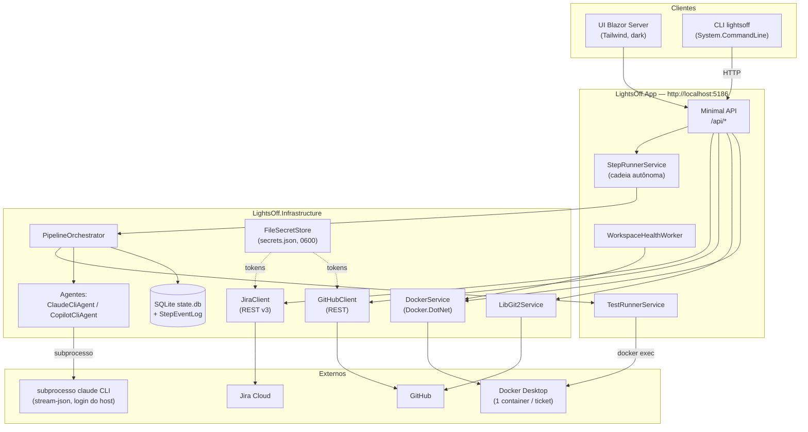
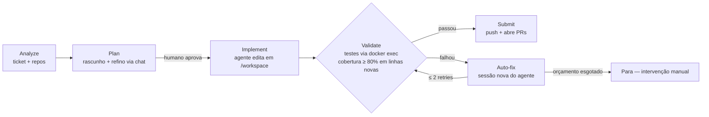

# Lights Off

> Tickets do Jira entram, pull requests saem — uma ferramenta de automação de tickets ponta a ponta, guiada por IA, que roda inteiramente na sua máquina.

[🇧🇷 Português](./LEIAME.md) | [🇺🇸 English](./README.md)

> 🚧 **Em construção.** O Lights Off é uma ferramenta privada, single-user, em desenvolvimento ativo. O pipeline principal funciona de ponta a ponta; várias funcionalidades de destaque ainda estão em andamento — veja o [Roadmap](#roadmap) honesto abaixo. (Sim, o repositório se chama `lighs-off` — um typo que ficou. O produto é **Lights Off**.)

## Sobre

O nome vem de [*lights-out manufacturing*](https://en.wikipedia.org/wiki/Lights_out_(manufacturing)): fábricas tão automatizadas que podem operar com as luzes apagadas. O Lights Off aplica essa ideia a tickets de software.

Você aponta a ferramenta para um board do Jira. Para um dado ticket, ela vai:

1. **Clonar** os repositórios do GitHub que você vincular ao ticket (um clone compartilhado por repo em `~/.lightsoff/repos/`).
2. **Criar a branch** `feature/{key}-{slug}` em cada repo (template configurável via `LightsOffOptions.BranchNameTemplate`).
3. **Subir um container Docker por ticket**, com cada repo vinculado montado via bind-mount em `/workspace/<repo>`.
4. **Rodar um pipeline de IA** — Analyze → Plan → Implement → Validate → Submit — usando um agente de código que trabalha *dentro* desse workspace.
5. **Abrir pull requests** no GitHub quando a validação passar.

É uma ferramenta local, single-user, construída em **.NET 10**: sem serviço hospedado, sem auth multi-tenant, sem telemetria. Tudo escuta em `http://localhost:5186` e todo o estado vive em `~/.lightsoff/`.

### O agente

O agente de código é o **CLI local do Claude Code**, iniciado como subprocesso falando `--input-format stream-json --output-format stream-json`. Ele reusa o login do `claude` já presente na sua máquina — **sem necessidade de API key** (`RequiresApiKey => false`). Um agente via **GitHub Copilot CLI** também está implementado como backend alternativo.

Duas proteções deliberadas:

- O system prompt do agente **proíbe rodar comandos de build, teste ou instalação de pacotes**. Verificação não é trabalho do agente.
- Os testes são executados pelo orquestrador via `docker exec` dentro do container do ticket, com **timeout de 10 minutos** por execução.

## O pipeline

Cinco fases, cada uma persistida como um `StepRun` com seu fluxo completo de eventos salvo em SQLite (`StepEventLog`) — os logs sobrevivem a reinícios e são reproduzidos (replay) sem perdas na UI:

| Fase | O que acontece |
|---|---|
| **1. Analyze** | O agente lê o ticket + repos e produz uma `TicketAnalysis` (incluindo perguntas de esclarecimento quando o ticket é vago — um `TicketQualityChecker` pontua o ticket antes). A análise é cacheada por SHA do HEAD de cada repo. |
| **2. Plan** | O agente rascunha um `ImplementationPlan`. Você refina via chat e precisa **aprovar** antes que o Implement seja liberado. |
| **3. Implement** | O agente edita o código dentro do workspace do container, seguindo o plano aprovado. |
| **4. Validate** | O orquestrador roda a suíte de testes do repo via `docker exec` (timeout de 10 min) e calcula cobertura. Gate: **≥ 80% de cobertura de linhas no código novo/alterado**. Em caso de falha, um **loop de auto-fix** devolve as falhas ao agente em uma sessão *nova* — até **2 retries** — antes de desistir. |
| **5. Submit** | As branches são enviadas (push) e pull requests abertos contra a branch padrão de cada repo, com os links exibidos na UI. |

Implement → Validate → Submit pode rodar como uma **cadeia autônoma** única (`StartAutonomousChain`): um clique, fases sequenciais, um token de cancelamento para toda a cadeia e parada imediata na primeira falha. Um sexto passo `Review` existe no modelo de domínio, mas ainda não está conectado (veja o Roadmap).

## Funcionalidades

- **Integração com Jira Cloud** (REST v3, Basic auth com e-mail + API token): navegar boards, filtrar tickets com JQL, definir board ativo.
- **Integração com GitHub** (REST, PAT fine-grained): navegar repos no escopo do token, clonar via LibGit2Sharp, fazer push de branches, abrir PRs.
- **Workspaces Docker por ticket** (Docker.DotNet): um container por ticket, cada repo vinculado montado em `/workspace/<repo>`, ciclo de vida start/stop/attach/destroy pela UI ou CLI.
- **Configuração de container por repo** via `.lightsoff.yaml` (imagem, ports, env, comandos pós-criação).
- **Agentes plugáveis**: Claude Code CLI (padrão, subprocesso stream-json) ou GitHub Copilot CLI.
- **Gate de cobertura + loop de auto-fix** no Validate (80% em linhas novas, 2 retries em sessões novas).
- **Replay de eventos sem perdas**: todo evento do agente é persistido em SQLite assim que chega; os logs dos passos são reproduzidos após reiniciar o app.
- **UI Blazor Server + API REST + CLI** compartilhando um mesmo core: o que a UI faz, o `lightsoff` (CLI) faz via HTTP.
- **Endpoint de health** (`GET /api/health`) checando banco, Docker, Jira e GitHub em paralelo.
- **Modo demo completo** — rode o produto inteiro sem nenhuma dependência externa (veja [Modo demo](#modo-demo)).

## Arquitetura

Quatro projetos em `lighs-off.slnx`, com camadas estritas — o `Core` não depende de infraestrutura:

```
lighs-off.slnx
├── src/
│   ├── LightsOff.Core/            # Modelos de domínio + abstrações (IJiraClient, ICodeAgent, …)
│   ├── LightsOff.Infrastructure/  # Jira REST v3, GitHub REST, LibGit2Sharp, Docker.DotNet,
│   │                              # subprocessos de agente, EF Core/SQLite, secrets, fakes de demo
│   ├── LightsOff.App/             # UI Blazor Server + minimal API (:5186) + serviços do pipeline
│   └── LightsOff.Cli/             # System.CommandLine, fala com o App via HTTP
└── tests/LightsOff.Tests/         # xUnit
```

### Diagrama de componentes



### Fluxo do pipeline



## Começando

### Pré-requisitos

- **.NET 10 SDK**
- **Docker Desktop** em execução
- **PAT fine-grained do GitHub** — mínimo `Metadata: Read` + `Contents: Read`; `Contents: Write` + `Pull requests: Read/Write` para o Submit
- **API token do Jira Cloud** (qualquer conta Atlassian com acesso ao board)
- **Claude Code CLI** instalado e logado (`claude` no PATH) — ou o GitHub Copilot CLI

### Executar

```sh
dotnet build lighs-off.slnx
dotnet test tests/LightsOff.Tests
dotnet run --project src/LightsOff.App
```

Abra [http://localhost:5186](http://localhost:5186) e então:

1. **/settings** — cole a URL base do Jira + e-mail + API token, e o PAT do GitHub. Clique em **Test & save**.
2. **/boards** — defina o board ativo.
3. **/tickets** — escolha um ticket, marque os repos a vincular, confirme o nome da branch, crie o workspace.
4. Rode o pipeline pela página do ticket — passo a passo, ou a cadeia autônoma Implement → Validate → Submit.

### CLI

O CLI fala com o App em execução em `http://localhost:5186` (sobrescreva com `LIGHTSOFF_API` ou `--api`).

```sh
dotnet run --project src/LightsOff.Cli -- --help

# Configuração de credenciais headless
lightsoff settings jira -u https://voce.atlassian.net -e voce@exemplo.com -t <jira-token>
lightsoff settings github --token ghp_...

# Fluxo do dia a dia
lightsoff boards list
lightsoff tickets list --board 42
lightsoff workspace create SCRUM-1 --repo meu-app --repo minha-api --summary "Corrigir login"
$(lightsoff workspace attach SCRUM-1)   # exec direto no container
lightsoff workspace submit SCRUM-1      # push das branches + abre PRs
lightsoff workspace destroy SCRUM-1
```

| Grupo | Subcomandos |
|---|---|
| `boards` | `list` |
| `tickets` | `list --board <id> [--jql …]` |
| `repos` | `list` / `add <name> --url … --branch … [--image …]` / `update` / `remove` |
| `workspace` | `list` / `create <KEY>` / `start` / `stop` / `attach` / `submit` / `destroy` |
| `settings` | `jira …` / `github …` |

Erros retornam como `application/problem+json`; o CLI imprime mensagens de uma linha como `lights-off: not found: Workspace SCRUM-1 not found.` e sai com código diferente de zero.

## Configuração

### Configuração de container por repo: `.lightsoff.yaml`

Coloque um `.lightsoff.yaml` (ou `.lightsoff.yml`) na raiz de qualquer repo registrado:

```yaml
image: node:20-alpine
ports:
  - "3000:3000"
  - "127.0.0.1:5432:5432"
env:
  NODE_ENV: development
  DEBUG: "app:*"
post_create_commands:
  - npm install
  - npm run db:migrate
```

- **image** — sobrescreve o padrão global. Se os repos vinculados divergirem, o primeiro vence (registrado em log).
- **ports** — `"N"`, `"HOST:CONTAINER"` ou `"IP:HOST:CONTAINER"`.
- **env** — variáveis injetadas no container.
- **post_create_commands** — executados dentro do container após o start, com `cd` em `/workspace/<repo>`. Falhas são logadas mas não abortam a criação.

### Layout do estado

Tudo vive em `~/.lightsoff/` — nada é escrito dentro do seu projeto:

```
~/.lightsoff/
├── state.db          # SQLite: repos, workspaces, settings, execuções de passos + log de eventos
├── secrets.json      # Tokens do Jira + GitHub (chmod 0600)
├── repos/            # Um clone por repo registrado
├── workspaces/       # Diretórios por ticket
└── logs/             # Saída do Serilog com rotação diária (retenção de 14 dias)
```

### Cola de permissões do PAT do GitHub

| Permissão | Acesso | Por quê |
|---|---|---|
| Repository / Metadata | Read | obrigatório para qualquer API de repo |
| Repository / Contents | Read | clone + leitura |
| Repository / Contents | **Write** | push de branches no Submit |
| Repository / Pull requests | Read/Write | criação de PRs |
| Organization / Members | Read | (opcional) seletor de orgs no Settings |

## Modo demo

Defina `LIGHTSOFF_DEMO=1` e inicie o App para rodar o **produto inteiro sem nenhuma dependência externa** — sem Jira, sem GitHub, sem Docker, sem CLI de agente:

```sh
LIGHTSOFF_DEMO=1 dotnet run --project src/LightsOff.App
```

O modo demo substitui todas as integrações por implementações fake (`DemoJiraClient`, `DemoGitHubClient`, `DemoDockerService`, `DemoCodeAgent`, `DemoPipelineOrchestrator`, …) com fixtures roteirizadas, incluindo replay determinístico de sessão de agente — útil para demonstrações, trabalho de UI e para experimentar o fluxo antes de configurar credenciais.

## Roadmap

Status honesto até o momento:

**Funcionando**

- Navegação de boards/tickets do Jira, registro de repos, browse do GitHub (no escopo do token)
- Ciclo de vida de workspace: clone → branch → container por ticket com bind-mounts multi-repo
- Pipeline de IA Analyze → Plan (com gate de aprovação) → Implement → Validate (gate de cobertura + auto-fix) → Submit (PRs)
- Cadeia autônoma Implement → Validate → Submit, parando na primeira falha
- Backends de agente Claude Code CLI + Copilot CLI; persistência/replay de eventos sem perdas
- Paridade do CLI, endpoint de health, logging estruturado, modo demo completo

**Em andamento**

- 🚧 **Chat unificado por linguagem natural** — um único chat que conduz todo o pipeline por intenção, sem botões. O backbone do roteador de intenções (`IIntentRouter` / `KeywordIntentRouter`, PT + EN) está implementado e testado; conectá-lo como a superfície única de chat no `TicketDetail` e renderizar cada passo inline ainda estão pendentes. Veja [docs/unified-chat-plan.md](docs/unified-chat-plan.md).

**Planejado, não iniciado**

- ⏳ **Loop de review de PR** — `PipelineStep.Review` existe no domínio mas não é usado. Ler threads de review (GraphQL), responder, endereçar apontamentos com o agente e resolver threads estão desenhados mas não implementados.
- ⏳ **Acesso remoto/mobile** — bind além do localhost, auth leve single-user, UI responsiva, documentação de túnel (Tailscale/Cloudflare).

**Limitações conhecidas**

- Apenas Jira **Cloud** (REST v3 + Basic auth). Server/Data Center exigiria suporte a bearer token.
- Apenas **GitHub**. GitLab/Bitbucket exigiriam clientes próprios.
- Single-user, sem auth — escuta em `http://localhost:5186` por decisão de projeto (por enquanto).

## Desenvolvimento

```sh
dotnet build lighs-off.slnx          # solução completa
dotnet test tests/LightsOff.Tests    # suíte xUnit
dotnet run --project src/LightsOff.App
```

Histórico de implementação: [docs/implementation-plan.md](docs/implementation-plan.md) · Plano do chat unificado: [docs/unified-chat-plan.md](docs/unified-chat-plan.md)
