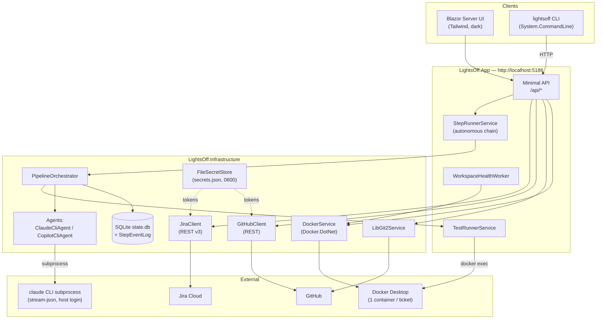
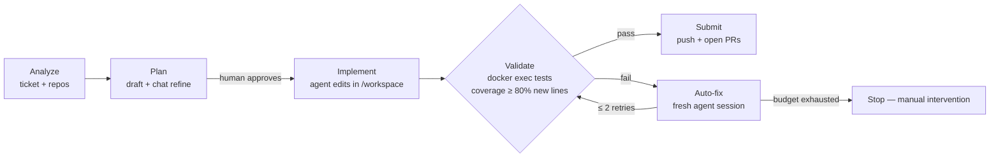

# Lights Off

> Jira tickets in, pull requests out — an AI-driven, end-to-end ticket automation tool that runs entirely on your machine.

[🇧🇷 Português](./LEIAME.md) | [🇺🇸 English](./README.md)

> 🚧 **Under construction.** Lights Off is a private, single-user tool being actively built. The core pipeline works end to end; several headline features are still in progress — see the honest [Roadmap](#roadmap) below. (Yes, the repo is named `lighs-off` — a typo that stuck. The product is **Lights Off**.)

## About

The name comes from [*lights-out manufacturing*](https://en.wikipedia.org/wiki/Lights_out_(manufacturing)): factories so automated they can run with the lights off. Lights Off applies that idea to software tickets.

You point it at a Jira board. For a given ticket it will:

1. **Clone** the GitHub repos you link to the ticket (one shared clone per repo under `~/.lightsoff/repos/`).
2. **Branch** each repo as `feature/{key}-{slug}` (template configurable via `LightsOffOptions.BranchNameTemplate`).
3. **Spin up a Docker container per ticket**, with every linked repo bind-mounted at `/workspace/<repo>`.
4. **Run an AI pipeline** — Analyze → Plan → Implement → Validate → Submit — using a coding agent that works *inside* that workspace.
5. **Open pull requests** on GitHub when validation passes.

It is a local, single-user tool built on **.NET 10**: no hosted service, no multi-tenant auth, no telemetry. Everything binds to `http://localhost:5186` and all state lives under `~/.lightsoff/`.

### The agent

The coding agent is your **local Claude Code CLI**, spawned as a subprocess speaking `--input-format stream-json --output-format stream-json`. It reuses the `claude` login already on your machine — **no API key required** (`RequiresApiKey => false`). A **GitHub Copilot CLI** agent is also implemented as an alternative backend.

Two deliberate guardrails:

- The agent's system prompt **forbids it from running build, test, or package-install commands**. Verification is not the agent's job.
- Tests are executed by the orchestrator via `docker exec` inside the ticket's container, with a **10-minute timeout** per run.

## The pipeline

Five phases, each persisted as a `StepRun` with its full event stream saved to SQLite (`StepEventLog`), so logs survive restarts and replay losslessly in the UI:

| Phase | What happens |
|---|---|
| **1. Analyze** | The agent reads the ticket + repos and produces a `TicketAnalysis` (including clarifying questions when the ticket is vague — a `TicketQualityChecker` scores it first). Analysis is cached per repo HEAD SHA. |
| **2. Plan** | The agent drafts an `ImplementationPlan`. You refine it via chat and must **approve** it before Implement unlocks. |
| **3. Implement** | The agent edits code inside the container workspace, following the approved plan. |
| **4. Validate** | The orchestrator runs the repo's test suite via `docker exec` (10 min timeout) and computes coverage. Gate: **≥ 80% line coverage on new/changed code**. On failure, an **auto-fix loop** feeds the failures back to the agent in a *fresh* session — up to **2 retries** — before giving up. |
| **5. Submit** | Branches are pushed and pull requests opened against each repo's default branch, with links surfaced in the UI. |

Implement → Validate → Submit can run as a single **autonomous chain** (`StartAutonomousChain`): one click, sequential phases, a chain-wide cancellation token, and a hard stop at the first failure. A sixth `Review` step exists in the domain model but is not wired up yet (see Roadmap).

## Features

- **Jira Cloud integration** (REST v3, Basic auth with email + API token): browse boards, filter tickets with JQL, set an active board.
- **GitHub integration** (REST, fine-grained PAT): browse token-scoped repos, clone via LibGit2Sharp, push branches, open PRs.
- **Per-ticket Docker workspaces** (Docker.DotNet): one container per ticket, every linked repo bind-mounted at `/workspace/<repo>`, start/stop/attach/destroy lifecycle from UI or CLI.
- **Per-repo container config** via `.lightsoff.yaml` (image, ports, env, post-create commands).
- **Pluggable agents**: Claude Code CLI (default, stream-json subprocess) or GitHub Copilot CLI.
- **Coverage gate + auto-fix loop** on Validate (80% on new lines, 2 retries in fresh sessions).
- **Lossless event replay**: every agent event is persisted to SQLite as it arrives; step logs replay after an app restart.
- **Blazor Server UI + REST API + CLI** sharing one core: whatever the UI does, `lightsoff` (the CLI) can do over HTTP.
- **Health endpoint** (`GET /api/health`) checking database, Docker, Jira, and GitHub in parallel.
- **Full demo mode** — run the whole product with zero external dependencies (see [Demo mode](#demo-mode)).

## Architecture

Four projects in `lighs-off.slnx`, strictly layered — `Core` has no infrastructure dependencies:

```
lighs-off.slnx
├── src/
│   ├── LightsOff.Core/            # Domain models + abstractions (IJiraClient, ICodeAgent, …)
│   ├── LightsOff.Infrastructure/  # Jira REST v3, GitHub REST, LibGit2Sharp, Docker.DotNet,
│   │                              # agent subprocesses, EF Core/SQLite, secrets, demo fakes
│   ├── LightsOff.App/             # Blazor Server UI + minimal API (:5186) + pipeline services
│   └── LightsOff.Cli/             # System.CommandLine, talks to the App over HTTP
└── tests/LightsOff.Tests/         # xUnit
```

### Component diagram



### Pipeline flow



## Getting started

### Prerequisites

- **.NET 10 SDK**
- **Docker Desktop**, running
- **GitHub fine-grained PAT** — `Metadata: Read` + `Contents: Read` minimum; `Contents: Write` + `Pull requests: Read/Write` for Submit
- **Jira Cloud API token** (any Atlassian account with board access)
- **Claude Code CLI** installed and logged in (`claude` on your PATH) — or the GitHub Copilot CLI

### Run

```sh
dotnet build lighs-off.slnx
dotnet test tests/LightsOff.Tests
dotnet run --project src/LightsOff.App
```

Open [http://localhost:5186](http://localhost:5186), then:

1. **/settings** — paste Jira base URL + email + API token, and the GitHub PAT. Click **Test & save**.
2. **/boards** — set your active board.
3. **/tickets** — pick a ticket, check the repos to link, confirm the branch name, create the workspace.
4. Run the pipeline from the ticket page — step by step, or the autonomous Implement → Validate → Submit chain.

### CLI

The CLI talks to the running App at `http://localhost:5186` (override with `LIGHTSOFF_API` or `--api`).

```sh
dotnet run --project src/LightsOff.Cli -- --help

# Headless credential setup
lightsoff settings jira -u https://you.atlassian.net -e you@example.com -t <jira-token>
lightsoff settings github --token ghp_...

# Everyday flow
lightsoff boards list
lightsoff tickets list --board 42
lightsoff workspace create SCRUM-1 --repo my-app --repo my-api --summary "Fix login"
$(lightsoff workspace attach SCRUM-1)   # exec straight into the container
lightsoff workspace submit SCRUM-1      # push branches + open PRs
lightsoff workspace destroy SCRUM-1
```

| Group | Subcommands |
|---|---|
| `boards` | `list` |
| `tickets` | `list --board <id> [--jql …]` |
| `repos` | `list` / `add <name> --url … --branch … [--image …]` / `update` / `remove` |
| `workspace` | `list` / `create <KEY>` / `start` / `stop` / `attach` / `submit` / `destroy` |
| `settings` | `jira …` / `github …` |

Errors come back as `application/problem+json`; the CLI prints one-liners like `lights-off: not found: Workspace SCRUM-1 not found.` and exits non-zero.

## Configuration

### Per-repo container config: `.lightsoff.yaml`

Drop a `.lightsoff.yaml` (or `.lightsoff.yml`) at the root of any registered repo:

```yaml
image: node:20-alpine
ports:
  - "3000:3000"
  - "127.0.0.1:5432:5432"
env:
  NODE_ENV: development
  DEBUG: "app:*"
post_create_commands:
  - npm install
  - npm run db:migrate
```

- **image** — overrides the global default. If linked repos disagree, the first one wins (logged).
- **ports** — `"N"`, `"HOST:CONTAINER"`, or `"IP:HOST:CONTAINER"`.
- **env** — variables injected into the container.
- **post_create_commands** — run inside the container after start, `cd`'d into `/workspace/<repo>`. Failures are logged but don't abort creation.

### State layout

Everything lives under `~/.lightsoff/` — nothing is written inside your project:

```
~/.lightsoff/
├── state.db          # SQLite: repos, workspaces, settings, step runs + event log
├── secrets.json      # Jira + GitHub tokens (chmod 0600)
├── repos/            # One clone per registered repo
├── workspaces/       # Per-ticket directories
└── logs/             # Daily-rolling Serilog output (14-day retention)
```

### GitHub PAT cheat sheet

| Permission | Access | Why |
|---|---|---|
| Repository / Metadata | Read | mandatory for any repo API |
| Repository / Contents | Read | clone + read |
| Repository / Contents | **Write** | push branches on Submit |
| Repository / Pull requests | Read/Write | PR creation |
| Organization / Members | Read | (optional) org picker in Settings |

## Demo mode

Set `LIGHTSOFF_DEMO=1` and start the App to run the **entire product with zero external dependencies** — no Jira, no GitHub, no Docker, no agent CLI:

```sh
LIGHTSOFF_DEMO=1 dotnet run --project src/LightsOff.App
```

Demo mode swaps in fake implementations of every integration (`DemoJiraClient`, `DemoGitHubClient`, `DemoDockerService`, `DemoCodeAgent`, `DemoPipelineOrchestrator`, …) with scripted fixtures, including a deterministic agent session replay — useful for demos, UI work, and trying the flow before wiring credentials.

## Roadmap

Honest status as of now:

**Working**

- Jira board/ticket browsing, repo registry, GitHub browse (token-scoped)
- Workspace lifecycle: clone → branch → per-ticket container with multi-repo bind mounts
- AI pipeline Analyze → Plan (with approval gate) → Implement → Validate (coverage gate + auto-fix) → Submit (PRs)
- Autonomous Implement → Validate → Submit chain, stopping at the first failure
- Claude Code CLI + Copilot CLI agent backends; lossless event persistence/replay
- CLI parity, health endpoint, structured logging, full demo mode

**In progress**

- 🚧 **Unified natural-language chat** — one chat that drives the whole pipeline by intent, no buttons. The intent-router backbone (`IIntentRouter` / `KeywordIntentRouter`, PT + EN) is implemented and tested; wiring it as the single chat surface in `TicketDetail` and rendering every step inline are still pending. See [docs/unified-chat-plan.md](docs/unified-chat-plan.md).

**Planned, not started**

- ⏳ **PR review loop** — `PipelineStep.Review` exists in the domain but is unused. Reading review threads (GraphQL), replying, addressing findings with the agent, and resolving threads are designed but not implemented.
- ⏳ **Remote/mobile access** — binding beyond localhost, lightweight single-user auth, responsive UI, tunnel docs (Tailscale/Cloudflare).

**Known limits**

- Jira **Cloud** only (REST v3 + Basic auth). Server/Data Center would need bearer-token support.
- **GitHub** only. GitLab/Bitbucket would need their own clients.
- Single user, no auth — binds to `http://localhost:5186` by design (for now).

## Development

```sh
dotnet build lighs-off.slnx          # full solution
dotnet test tests/LightsOff.Tests    # xUnit suite
dotnet run --project src/LightsOff.App
```

Implementation history: [docs/implementation-plan.md](docs/implementation-plan.md) · Unified chat plan: [docs/unified-chat-plan.md](docs/unified-chat-plan.md)
